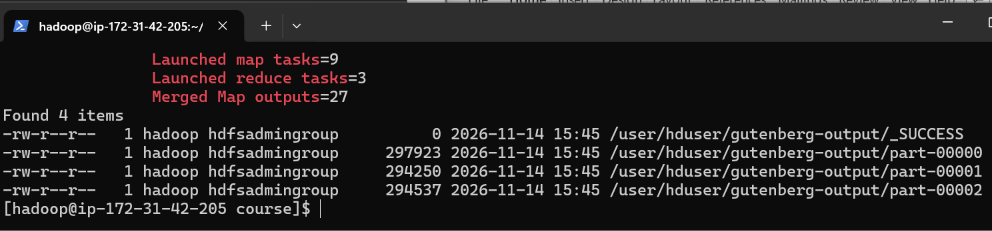
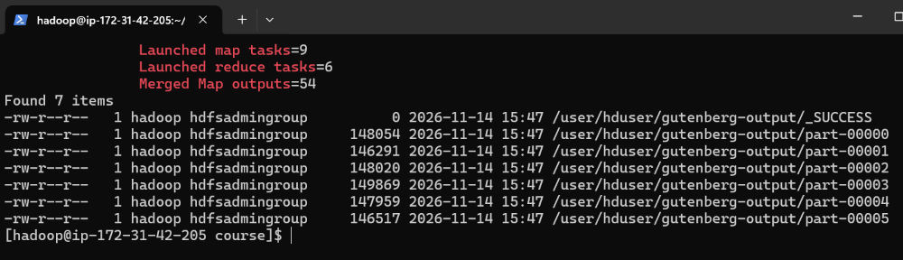
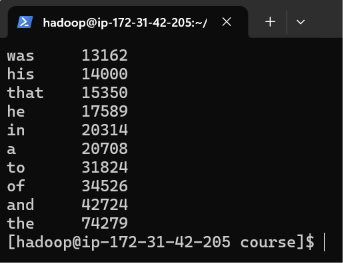
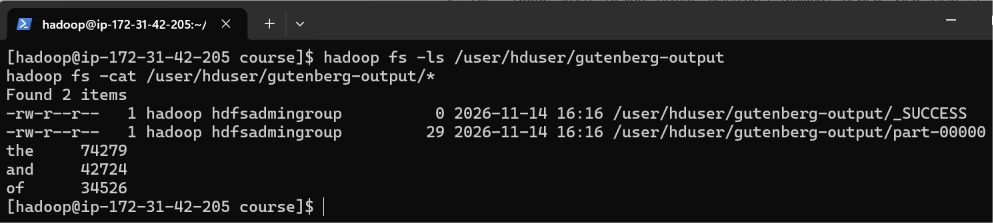

# Hadoop Training – Answers

Environment: Amazon EMR 7.14.0 (Core Hadoop bundle), region N. Virginia (us-east-1).
Input: three Project Gutenberg books (`5000-0.txt`, `2600-0.txt`, `1399-0.txt`) copied to HDFS at `/user/hadoop/gutenberg`.
Jobs were run with Hadoop Streaming and Python.

---

## Exercise 1

Code: [`ex1/mapper_original.py`](ex1/mapper_original.py), [`ex1/reducer.py`](ex1/reducer.py)

| Job Counter | Run 1 (default reducers) | Run 2 (`-numReduceTasks 6`) |
|---|---|---|
| Launched map tasks | 9 | 9 |
| Launched reduce tasks | 3 | 6 |
| Merged Map outputs | 27 | 54 |
| Output data files | 3 | 6 |

Run 1 – counters and output directory:



Run 2 – counters and output directory:



**Q1. How many files are there?**
In the first run there were 3 data files.
After the second run there are 6 data files (`part-00000` to `part-00005`), plus the empty `_SUCCESS` marker file (7 items in total).

**Q2. Did the number of mappers change?**
No, it stayed at 9. The number of mappers depends on the input splits, and the input of the books did not change between the two runs.

**Q3. Did the number of reducers change?**
Yes, it changed from 3 (the default) to 6, because we set `-numReduceTasks 6` explicitly.

**Q4. Did the number of output files change? Why?**
Yes, from 3 to 6. Each reducer writes its own output file (`part-0000N`), so the number of output files equals the number of reducers.

**Q5. What does the value of 'Merged Map outputs' represent, and how is it calculated?**
It is the number of map-output segments that the reducers fetched and merged during the shuffle phase. Each reducer needs its partition of the output of every mapper, so the value equals (number of map tasks) × (number of reduce tasks): 9 × 3 = 27 in the first run and 9 × 6 = 54 in the second.

---

## Exercise 2

Code: [`ex2/mapper.py`](ex2/mapper.py) (changed), [`ex2/reducer.py`](ex2/reducer.py) (unchanged)

The mapper now strips trailing commas and dots and lowercases every word. the changed lines from the original mapper:

```python
word = word.rstrip(',.').lower()
if word:
    print('%s%s%d' % (word, separator, 1))
```

Top 10 words after the change (`hadoop fs -cat ... | sort -nk2 | tail -n 10`):



**Q1. Is your change in the mapper or in the reducer?**
In the mapper. The cleaning has to happen before the shuffle, so that `The`, `the,` and `the` are treated as the same key and reach the same reducer.

**Q2. Please provide your code on GitHub**
See [`ex2/mapper.py`](ex2/mapper.py) and [`ex2/reducer.py`](ex2/reducer.py).

---

## Exercise 3

Code: [`ex3/mapper.py`](ex3/mapper.py) (same as Exercise 2), [`ex3/reducer_top3.py`](ex3/reducer_top3.py)

The job was run with `-numReduceTasks 1`. No external pipes, sort or filters were used – the top 3 selection is done inside the reducer (a small min-heap that keeps only the 3 largest counts).

**Q1. Is your change in the mapper or in the reducer?**
In the reducer. Only the reducer sees the final total count of each word, so it keeps the 3 highest counts and prints them at the end. With several reducers each one would print its own top 3 (3 × 3 = 9 lines), so a single reducer is used.

**Q2. Please provide your code on GitHub**
See [`ex3/mapper.py`](ex3/mapper.py) and [`ex3/reducer_top3.py`](ex3/reducer_top3.py).

**Q3. Print the output of the MapReduce**

Screenshot after `hadoop fs -ls /user/hduser/gutenberg-output` and `hadoop fs -cat /user/hduser/gutenberg-output/*`:



```
the     74279
and     42724
of      34526
```
